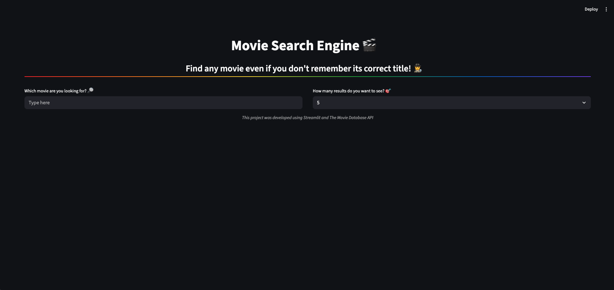
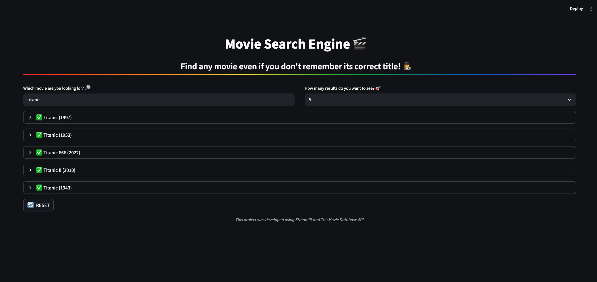
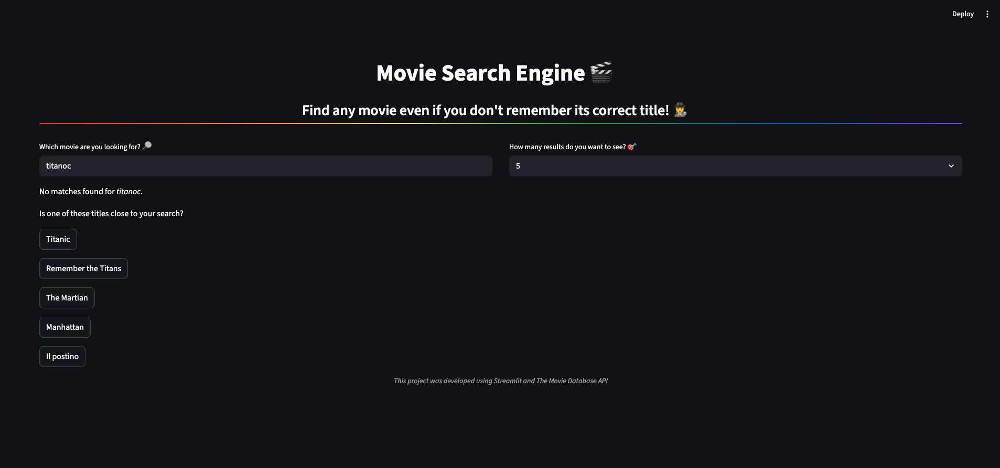

# Movie Search Engine 🎬

A Python web application that helps users find movies, even when they don't remember the exact title.

The application uses the **TMDB API** to search for movies and display information such as posters, ratings, and synopses.

If no results are found, **RapidFuzz** is used to suggest similar movie titles from a local IMDb dataset. This helps users find the movie they are looking for, even when they make spelling mistakes or only remember part of the title.

---

## Project Structure

```
Find_Movies/
├── assets/                     # Screenshots of the application
├── data/
│   └── top_1000_imdb_movies.csv
├── utils/
│   ├── candidates_search.py    # Finds similar movie titles using RapidFuzz
│   ├── display_results.py      # Displays movie results in the interface
│   ├── read_data.py            # Loads the IMDb dataset
│   ├── reset.py                # Resets the search
│   └── tmdb.py                 # Handles requests to the TMDB API
├── main.py                     # Main application and user interface
├── .env                        # Stores the TMDB access token
├── .gitignore
├── requirements.txt
└── README.md
```

## Features and Technologies

### Movie Search
- Searches for movies using the TMDB API.
- Displays movie posters, ratings, release years, and synopses.
- Allows users to choose how many results they want to see.

### Similar Title Suggestions
- Uses RapidFuzz to find similar titles when the TMDB API returns no results.
- Searches a local IMDb dataset containing 1,000 movie entries.
- Helps users find movies when they make spelling mistakes or enter incomplete titles.

### Performance and Error Handling
- Uses Streamlit's `@st.cache_data` decorator to reduce repeated API requests and avoid loading the dataset again unnecessarily.
- Handles common errors, such as connection problems, request timeouts, and invalid server responses.

### Technologies
- **Python** — Main programming language.
- **Streamlit** — Builds the web interface.
- **TMDB API** — Provides movie search results and information.
- **RapidFuzz** — Finds similar movie titles.
- **Pandas** — Loads the local IMDb dataset.
- **Requests** — Sends HTTP requests to the TMDB API.
- **python-dotenv** — Loads the TMDB access token from environment variables.

## Installation and Usage

### 1. Clone the repository

```bash
git clone https://github.com/zegostinho/movie-search-engine-python.git
cd movie-search-engine-python
```

### 2. Create and activate a virtual environment (optional but recommended)

```bash
python -m venv .venv
```

On macOS and Linux:

```bash
source .venv/bin/activate
```

On Windows:

```bash
.venv\Scripts\activate
```

### 3. Install the dependencies

```bash
python -m pip install -r requirements.txt
```

### 4. Configure the TMDB API token

Create a `.env` file in the project root directory and add your TMDB Read Access Token:

```text
TMDB_ACCESS_TOKEN=your_token_here
```

Replace `your_token_here` with your own token. You can obtain a token through your TMDB account.

**Important:** Never share your access token or upload your `.env` file to GitHub.

### 5. Run the application

```bash
streamlit run main.py
```

Streamlit will start the application and provide a local URL that you can open in your browser.
## Interface

**Homepage:**


**Search Results:**



---

## 🚀 Try it out!
Click here and try it out:
👉 [Movie Search Engine](https://movie-search-engine-python-zegostinho.streamlit.app/)

## Acknowledgements

Movie data is provided by [The Movie Database (TMDB)](https://www.themoviedb.org/).

This product uses the TMDB API but is not endorsed or certified by TMDB.